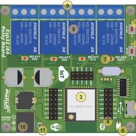

# Esp32 IX4 Relay Board — راهنمای کامل سخت‌افزار + توسعه

مرجع بازمهندسی برد تجاری **«برد چهار رله Esp32 ایرانیک (Esp32 IX4 Relay Board)»** از [iranicboard.ir](https://iranicboard.ir/product/%D8%A8%D8%B1%D8%AF-%DA%A9%D8%A7%D8%B1%D8%A8%D8%B1%D8%AF%DB%8C-%D8%B5%D9%86%D8%B9%D8%AA%DB%8C-%DA%86%D9%87%D8%A7%D8%B1-%D8%B1%D9%84%D9%87-iot-%D8%A8%D8%B1-%D8%A7%D8%B3%D8%A7%D8%B3-%D9%85%D8%A7%DA%98/) / [ECA](https://eshop.eca.ir/brand/3-%D8%A7%DB%8C%D8%B1%D8%A7%D9%86%DB%8C%DA%A9) — با هدف اینکه برای هر توسعه سخت‌افزاری/نرم‌افزاری به جای دیگری مراجعه نکنید.



## 🔑 کلیدترین اطلاعات در یک نگاه

| مورد | مقدار |
|---|---|
| ماژول | ESP-WROOM-32 (ESP32-D0WDQ6، فلش 4MB) — از روی عکس شیلد |
| **نگاشت رله‌ها** | RELAY1→**GPIO4** ، RELAY2→**GPIO2** ، RELAY3→**GPIO13** ، RELAY4→**GPIO12** (سیلک: D04/D02/D13/D12) |
| رله | JQC-3F(T73)-DC12V (کنتاکت 10A/250VAC؛ فروشگاه 7A@220VAC مقاومتی) |
| USB↔UART | **CH340G** + کریستال 12MHz (پشت برد) — درایور: [CH341SER](https://sparks.gogo.co.nz/ch340.html) |
| پورت USB | **Micro USB** (عکس شماره‌دار رسمی: «ورودی USB MICRO» — متن بازاریابی Type‑C گفته که طبق عکس رسمی نیست) |
| تغذیه | جک 12V (۵٫۵mm، ≥1A) → LM2596‐5.0 (باک) → AMS1117‐3.3 ⛔ 24V مستقیم ممنوع |
| کلیدها | FLASH (GPIO0↔GND) و RESET (EN↔GND) در لبه بالایی |
| LEDها | PWR + RX + TX + ۴ عدد وضعیت رله |
| توسعه | همه GPIOهای ماژول روی دو هدر کناری |
| ابعاد | ≈ ۸۰×۷۰mm، ۴ سوراخ مونتاژ |

## 🧭 ساختار ریپو

| مسیر | محتوا |
|---|---|
| `docs/ESP32_WROOM_REFERENCE.md` | **مرجع کامل ESP32-WROOM-32**: پین‌اوت ۳۸ پایه، استرپینگ‌ها، ADC/DAC/I2C/SPI/UART، تغذیه، نکات Arduino — سند اصلی توسعه |
| `docs/schematic.svg` | شماتیک بازسازی‌شده (تغذیه، CH340+اتورست، ماژول، ۴ کانال S8050+JQC-3F، هدرها، هشدارها) |
| `docs/TASMOTA.md` | تحلیل فریمور Tasmota + تمپلیت‌ها + دستورهای آماده (RF، قفل‌متقابل، پالس) |
| `docs/reference-photos/` | عکس رسمی شماره‌دار + نقشه نگاشت وب‌UI |
| `viewer/board_3d.html` | **نمای سه‌بعدی تعاملی تک‌فایل** — چرخش/زوم/کلیک روی قطعات، پشت برد هم مدل شده (CH340G، کریستال، درایورها) |
| `tasmota/template_esp32_ix4.json` | تمپلیت آماده این برد برای Tasmota |
| `firmware/pin_finder.ino` | راستی‌آزمایی نگاشت ۴/۲/۱۳/۱۲ |
| `firmware/webserver_relay.ino` | وب‌سرور کنترل رله (بدون وابستگی خارجی) — هم‌خانواده با [دموی رسمی](https://server4.eca.ir/eshop/000/IRANICBoard/ESP32/IRANICBoard_ESP32_WebServer_3011027068.rar) (که ESPAsyncWeb + WebSockets است) |

## 🚀 شروع سریع

```cpp
// RELAY pins — esp32 IX4 (active HIGH → NPN → coil)
const uint8_t RELAYS[4] = {4, 2, 13, 12};
for (auto p : RELAYS) { pinMode(p, OUTPUT); digitalWrite(p, LOW); }
```

- آردینو: برد = **ESP32 Dev Module**، پورت = مجازی CH340.
- Tasmota: نصب `tasmota32.bin` از [Tasmota Web Installer](https://tasmota.github.io/install/) ← سپس تمپلیت `tasmota/template_esp32_ix4.json` در Configuration → Other.
- [ریپوی خواهر: ESP-07 4relay](https://github.com/ghahremany/esp07-4relay-board) — همان فورم‌فاکتور با ESP-07 + نسخه RF433.

## ⚠️ نکات بوت و تله‌ها

- GPIO2 و GPIO12 **پایه استرپینگ** بوت‌اند و روی این برد رله هستند؛ عملاً بوت سالم است، اما مدار جانبی روی این دو پایه در لحظه روشن‌شدن نباید آن‌ها را بالا نگه دارد (هشدار رسمی فروشگاه هم آمده).
- GPIO9..11 (و 6..8) = فلش SPI — استفاده ممنوع. GPIO34/35/36/39 فقط ورودی (بدون pull داخلی). ADC2 با WiFi تداخل دارد ← ADC1.
- جریان لحظه‌ای WiFi ESP32 تا ~500mA پیک دارد؛ تغذیه 12V/1A به‌حداقل رسانده نشود.
- برد ایزوله نیست — برق شهر فقط در محفظه عایق + فیوز + خزش ≥6mm.

## مجوز
MIT — `LICENSE`. عکس‌های مرجع متعلق به ایرانیک/ECA و صرفاً برای مستندات بازمهندسی‌اند.
